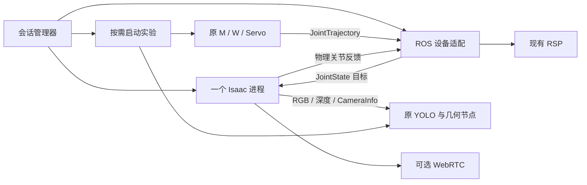

# 架构与接口

本工程提供仿真设备，主项目消费现有 ROS 接口。主项目以外部源码目录接入，所有仿真配置、模型适配、启动组合和协调代码留在本工程。

## 目录

| 目录 | 职责 |
|---|---|
| deploy | 系统依赖、外置构建、配置和 engine 生成 |
| runtime/isaac | 唯一 Isaac 场景、物理、相机和 ROS Bridge |
| runtime/streaming | TURN 配置和 NVENC 支持 |
| runtime | 命令、SSH 所有权、进程生命周期与配置 |
| ros2/piper_sim_devices | 标准 ROS 机械臂转接与相机安装静态 TF |
| ros2/nankai_sim_integration | 现有主项目 launch 组合、碰撞安装接触、实验协调 |
| models | 机器人装配、物品制作和完整场景打包 |
| config | 基础版本、机器示例和场景契约 |
| checks / tests | GPU／ROS 验收与不需要 GPU 的测试 |

## 进程与数据流

普通 ROS 节点使用系统 Python 3.10，Isaac 使用独立 Python 3.12。环境包装器清除相互污染的 Python／动态库路径，通过同机 DDS 交换标准消息。

## 设备契约

- command：现有 namespace 下单点六轴 `JointTrajectory`，关节名 joint1–joint6，位置为弧度。不新增轨迹队列。
- joint_states：实际物理状态，不镜像位置目标。手指关节使用米。
- 相机：640×480 RGB、同一渲染产品的 `32FC1` 米制光轴 Z 深度、对应原始畸变的 CameraInfo；RGB／深度／内参采集时间一致。
- 机械臂动态 TF 和 TCP 来自现有 RSP；仿真仅发布 link6 到 optical frame 的安装静态 TF。
- 设备 launch 不启动 RSP；主项目实验 launch 或独立设备验收启动 RSP，避免重复发布动态 TF。
- `/clock` 由 Isaac 发布，业务和设备 ROS 节点使用 `use_sim_time=true`。
- 原厂 USD 提供质量、惯量、增益、限位和求解设置。增益配置是断言，不是覆盖值。运动学锚点对齐写入 session layer，不保存输入场景。
- 感知业务只接收渲染与 ROS 数据。USD 真值只用于离线验收。

基础设备使用资产包内的已验证 URDF；接入主项目后用其当前模型生成器生成仿真侧模型，并加入相机、支架和桌面碰撞。固定底座与桌面的安装接触可允许，活动连杆的碰撞检查保留。

## 生命周期

串流采用既定的 AutoDL TCP／TURN／HAProxy 链路，SSH 管理会话。网络拓扑及不能简化的环节见[串流网络约束](streaming-network.md)，本轮只整理所属代码与生命周期。

管理器拥有设备和可选串流进程；ROS launch 不再创建 Isaac。实验有独立进程组，取消或实验结束不关闭设备。关闭设备同时清理实验。

实验组合通过独立的 `ros2 launch` 进程调用主项目原有 `grasp_alignment.launch.py`。其全局退出检查只观察自身业务节点，仿真协调器正常完成或取消不会被误判为主项目故障；这个边界由仿真侧处理。

同一数据目录的运行、验收、部署、构建和资产导入共用排他锁，Isaac 另有 GPU 0 排他锁。清理只针对本会话进程组，以 PID starttime 避免 PID 复用。管理 SSH 断开会终止所属服务器管理器及子进程。`watchdog_seconds` 默认 4500，设为 0 可关闭会话时限。

本轮不提供独立于管理 SSH 的后台 supervisor，不保留旧 relay 路线。
