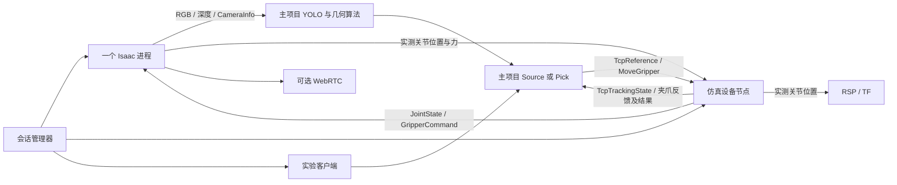

# 架构与接口

本工程为持续开发的主项目提供仿真设备。主项目源码保持只读；设备实现、配置、模型对齐、启动组合和实验记录都在本仓库。主项目版本由开发者显式更新，本工程不固定或自动切换版本。

## 目录与数据流

| 目录 | 职责 |
|---|---|
| deploy | 系统依赖、外置 ROS 构建、模型对齐和 engine 构建 |
| runtime/isaac | 一个 Isaac 进程：场景、物理、相机、标准 ROS Bridge 和夹爪执行 |
| runtime/streaming | 既有 TURN/TCP、HAProxy 与 NVENC 支持 |
| runtime | CLI、SSH 所有权、进程生命周期、profile 和本次会话配置 |
| ros2/piper_sim_devices | 仿真 TCP／夹爪驱动、实测关节 RSP、相机安装 TF |
| ros2/nankai_sim_integration | 启动主项目 Source 或 Pick、检测器，以及实验客户端 |
| models | 机器人／物品制作、派生控制场景和可选资产打包 |
| config | 基础版本、机器示例与远端场景 profiles |
| checks / tests | GPU／ROS 验收与离线回归 |

普通 ROS 使用系统 Python 3.10／Humble，Isaac 使用独立 Python 3.12 和内置 Humble。环境包装器隔离两边的 Python 与动态库路径，通过同机 DDS 交换消息。

## 设备契约

默认 namespace 为 `/piper/arm`，由 profile 统一传给驱动和业务。

| 接口 | 类型与语义 |
|---|---|
| reference | 主项目 TcpReference，piper_base_link 中的 grasp_tcp 目标；TRACK／HOLD |
| state | 主项目 TcpTrackingState；按实际关节 FK 判断误差和到位 |
| joint_states | 实际六轴 rad、实际 joint7/8 m；分别发布，QoS depth 2 |
| gripper_state | JointState：name=[gripper]，position 为总开度 m，effort 为有符号等效力 N |
| move_gripper | 主项目 MoveGripper Action；宽度、请求力、取消、反馈和终态 |
| diagnostics | 仿真实测输入状态；不伪造 CAN 设备诊断 |

`piper_sim_devices` 在自己的构建目录直接编译外部主项目的 Motion／Control／IK 源码。上游尚未导出控制库，因此构建时需要源码路径；没有复制维护第二份算法。进程内转换核心已有的协议输入输出，不创建 CAN Worker、虚拟 CAN 或 Mock 执行器。只运行仿真设备节点，不启动主项目的实机／Mock 宏驱动。

机械臂目标使用 `/isaac/piper/joint_command` 的 JointState。夹爪使用 `/isaac/piper/gripper_command` 的标准 control_msgs/GripperCommand：position 是总开度，max_effort 是单指驱动力上限，受 USD 原有上限约束。Isaac 继续以原刚度／阻尼跟踪位置；请求力不是直接追加在 PD 上的力。

实际开度为 q7−q8；对称目标为 q7=width/2、q8=−width/2。从 PhysX 实测 effort 计算 F=(e7−e8)/2，正值张开、负值闭合；这是开度坐标的等效力，不是标定后的指尖测力。原始两个手指实际位置仍分别发布，保留不对称接触。不得将请求力回填为反馈；缺测不生成新力样本。

夹爪沿用主项目 0.5 s 稳定窗口、WIDTH_REACHED／CONTACT_STOP、张开受阻和取消语义。成功后保留位置与力上限；取消使用测得宽度和原请求力。新旧 Action ABI 不兼容，接口、设备节点和业务客户端须统一重建并重启。

## TF、相机、时间与模型

- 设备 launch 持续拥有唯一 RSP。动态机械臂 TF 来自实测关节，固定 TCP 来自派生 ROS 模型；相机安装只发布 link6→optical frame 的静态 TF。
- ROS 固定根链接 piper_base_link→base_link 保留 USD 现有物理 body 名字，两者坐标一致。
- 相机保持 640×480 RGB、32FC1 米制光轴深度，以及匹配原始畸变的 CameraInfo。三者采集时间一致。
- Isaac 发布 `/clock`，设备、RSP、检测器和业务均使用 use_sim_time=true。没有新物理反馈或时间暂停时不追加控制步长，也不推进夹爪观察窗口；wall timer 继续处理取消。重置时间前先结束实验，重置后重启设备。
- 显式 build 从当前宏驱动模型生成 ROS URDF，并创建引用源 USD 的派生层：对齐关节坐标与限位，保留源场景的质量、惯量、增益、碰撞过滤、相机和环境。启动只读校验八个关节，不写锚点。
- 新宏驱动不包含旧 W 的规划场景和距离减速；旧 scene_boxes／SRDF 不再参与控制。PhysX 中的实际碰撞仍生效。
- 7up profile 显式配置瓶子动态刚体及联调基线：0.3 kg、静／动摩擦 0.8／0.6、恢复系数 0，惯量由碰撞几何计算。这些不是实测标定值。

基础设备模式不要求主项目，仅转发实测关节到 RSP、提供相机和原始 Bridge；TCP 与夹爪 Action 需要配置 main_project 并显式构建。

## 会话与生命周期

start 在会话锁内读取远端 profile，检查构建产物，写入本次日志目录的 profile/devices 配置；接入主项目时另写 alignment/pick/detector。派生 USD 引用源场景，因此环境、材质修改仍在下一次启动读取。启动不复制管理机 YAML、不同步 Git、不编译或重建 engine。

设备与串流由管理器持续拥有，实验有独立进程组。`experiment start` 运行预定位，`experiment start --task pick` 调用主项目 Pick Action；二者不同时运行。取消／失败沿用业务的 HOLD 和夹爪取消；正常 Pick 成功后保留携带目标与夹持。实验退出不关闭设备。

Pick 入口在仿真包内实例化原有主项目 PickNode，仅负责信号和退出顺序：先结束回调、销毁节点，再关闭 ROS context，避免 Humble 在退出时中断消息接收。业务阶段与完成判据仍来自主项目。

部署、构建、会话与 GPU 验收共用数据目录排他锁，Isaac 另有 GPU 0 锁。SSH 管理连接断开会清理所拥有的进程；watchdog_seconds 默认 4500，0 表示关闭时限。串流网络保持既有架构，细节见[网络约束](streaming-network.md)。
